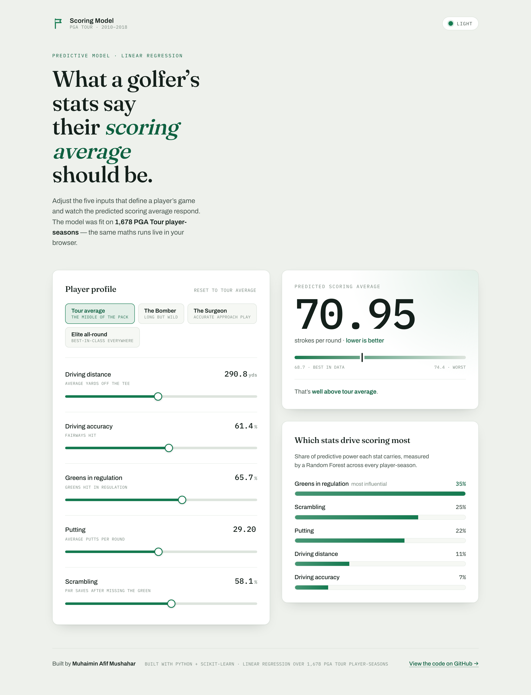

# Golf Scoring Model

Predict a PGA Tour player's **scoring average** from five performance stats —
and see which parts of the game drive scoring the most.

**[▶ Live demo](https://mpip0505.github.io/golf-score-predictor/)** · built with Python, pandas, scikit-learn & Streamlit



---

## What it does

Give the model a player's driving distance, driving accuracy, greens in
regulation, putting, and scrambling, and it predicts their scoring average for
the season. It was trained on **1,678 PGA Tour player-seasons (2010–2018)**.

There are two ways to use the PGA predictor:

- **A static web app** (`web/`) — a polished, phone-friendly page where you
  drag sliders and watch the prediction update live. The trained model is small
  enough to run entirely in the browser, so there's no server. **This is the
  [live demo](https://mpip0505.github.io/golf-score-predictor/).**
- **A Streamlit app** (`app.py`) — the same predictor, running the real Python
  model directly.

## The personal round tracker (Phases 7–9)

The project then turned towards **amateur** golf: a Streamlit app
(`08_round_tracker.py`) where you log your own rounds and see which part of
your game costs you the most strokes.

- Your stats (fairways, greens, putts, penalties, up-and-downs) are compared
  with **amateur benchmarks by handicap** (Shot Scope Strokes Gained eBook,
  2021), not with PGA pros. Each gap is turned into strokes so the areas can be
  ranked in the same unit.
- It estimates a handicap index from your 18-hole rounds that have a course
  rating and slope, following the WHS formula. It's always labelled
  **"ESTIMATED, not official"**.
- Your rounds are saved locally in `data/my_rounds.csv`, which is **gitignored**
  and never leaves your computer. Every save is atomic and backed up first
  (newest 30 kept in `data/backups/`).
- The app only listens on this computer (`.streamlit/config.toml` sets
  `address = "localhost"`).
- Every judgement call (for example "a failed up-and-down costs 1 stroke") lives
  in `strokes_config.py` and is listed in the app under **Known limitations**.

## What I learned (the interesting bit)

I trained two models and compared them honestly instead of assuming the fancier
one would win:

| Model | R² (5-fold CV) | RMSE |
|---|---|---|
| **Linear Regression** | **0.678 ± 0.056** | **0.391 strokes** |
| Random Forest | 0.619 ± 0.049 | 0.427 strokes |

The **Random Forest overfit** — it nearly memorised the training data (train
R² 0.945) but did *worse* on unseen players than the simple Linear Regression
baseline, which won all 5 cross-validation folds. A more complex model isn't
automatically better; it has to earn its complexity. Full write-up in
**[`FINDINGS.md`](FINDINGS.md)**.

The feature importances also line up with real golf analytics — *"drive for
show, putt/approach for dough"*:

| Stat | Share of predictive power |
|---|---|
| Greens in regulation | 35% |
| Scrambling | 25% |
| Putting | 22% |
| Driving distance | 11% |
| Driving accuracy | 7% |

## Tech stack

Python · pandas · scikit-learn · Streamlit · vanilla HTML/CSS/JS (no framework)

## Project structure

```
├── data/pgaTourData.csv        # PGA Tour player-season stats, 2010–2018
├── 01_explore_data.py          # Phase 1 — load & summarise the data
├── 02_clean_data.py            # Phase 2 — clean, pick features & target
├── 03_train_baseline.py        # Phase 3 — Linear Regression baseline
├── 04_train_random_forest.py   # Phase 4 — Random Forest + overfitting check
├── 05_cross_validation.py      # Phase 4.5 — 5-fold cross-validation
├── 06_strokes_gained.py        # Phase 6 — Strokes Gained columns (rejected: they leak the target)
├── 07_handicap_benchmarks.py   # Phase 7 — amateur benchmarks by handicap
├── 08_round_tracker.py         # Phase 8 — personal round tracker (Streamlit)
├── 09_course_aware_checks.py   # Phase 9 — prints the numbers behind the WHS maths
├── app.py                      # Streamlit app (runs the real Python model)
├── benchmarks.py               # load the benchmark CSV, interpolate by handicap
├── rounds.py                   # round fields, parsing, validation
├── storage.py                  # safe saving: atomic writes, backups, import/export
├── handicap.py                 # estimated index + expected scores (WHS-based)
├── strokes_lost.py             # the "where am I losing strokes?" report
├── strokes_config.py           # every judgement-call setting, in one place
├── selfcheck.py                # automated checks for the tracker (PASS/FAIL)
├── data/
│   ├── handicap_benchmarks.csv # amateur averages by handicap (Shot Scope)
│   └── my_rounds.example.csv   # empty template (your real my_rounds.csv is gitignored)
├── .streamlit/config.toml      # keeps Streamlit apps local-only
├── web/                        # Static web app (browser-only, deployed to Pages)
│   ├── index.html
│   ├── styles.css
│   └── predictor.js            # the trained model, ported to JavaScript
├── FINDINGS.md                 # detailed results & interpretation per phase
├── TESTING.md                  # step-by-step checklist for testing the tracker
└── requirements.txt
```

The numbered scripts build the project up phase by phase — run them in order to
follow the same path from raw CSV to trained model.

## Run it locally

### The web app (no Python needed)

```bash
python3 -m http.server 8000 --directory web
# then open http://localhost:8000
```

Or just open `web/index.html` directly in your browser.

### The Python side (phase scripts + Streamlit)

```bash
python3 -m venv venv
source venv/bin/activate          # Windows: venv\Scripts\activate
pip install -r requirements.txt

python 01_explore_data.py         # run any phase script
streamlit run app.py              # launch the PGA predictor app
streamlit run 08_round_tracker.py # launch the personal round tracker
```

## Testing the round tracker

The full checklist, with what to expect at each step, is in
**[`TESTING.md`](TESTING.md)**. In short, from the project folder with the venv
active (`source venv/bin/activate`):

**1. Run the self-check.** It tests saving, validation, backups, the index
rules and the app itself, all on a throwaway folder. It never touches your
real rounds.

```bash
python selfcheck.py
```

Every line should say `PASS`, ending with `23 of 23 checks passed.` (The
"missing ScriptRunContext" warnings at the top are harmless.) It exits with
code 1 if anything fails.

**2. Try the app in practice mode.** Setting `ROUND_DATA_DIR` points the app at
a scratch folder, so you can log made-up rounds and try invalid input safely:

```bash
ROUND_DATA_DIR=/tmp/golf_scratch streamlit run 08_round_tracker.py
```

A yellow **"Practice mode"** banner at the top confirms you're not on your real
data. Open the `localhost` URL Streamlit prints, work through Part A of
`TESTING.md`, then stop the app (Ctrl+C) and clean up with
`rm -rf /tmp/golf_scratch`.

**3. Log real rounds.** Start the app without the variable:

```bash
streamlit run 08_round_tracker.py
```

There must be **no** Practice mode banner. Rounds go to `data/my_rounds.csv`.
Follow Part B of `TESTING.md`, and export a copy of your rounds outside the
project now and then (**Export / Import → Download my rounds**). Don't edit the
CSV in Excel or Google Sheets: they can rewrite the dates.

## How the prediction works

The model is a linear regression, which is just a weighted sum of the inputs:

```
predicted_score = intercept + Σ (weight_i × stat_i)
```

Because that's plain arithmetic, the coefficients learned in Python are copied
into `web/predictor.js` and produce the *exact same* prediction in the browser.

## Deploying to GitHub Pages

The included workflow (`.github/workflows/deploy-pages.yml`) publishes the
`web/` folder automatically. One-time setup: **Settings → Pages → Source →
"GitHub Actions"**. After that, every push to `main` redeploys the live demo.

## Data

`data/pgaTourData.csv` — public PGA Tour performance statistics, 2010–2018
(one row per player per season).

`data/handicap_benchmarks.csv` — amateur average stats at handicaps 0, 5, 10,
15, 20 and 25, from the Shot Scope Strokes Gained eBook (4th ed., 2021).

## License

[MIT](LICENSE) © Muhaimin Afif Mushahar
